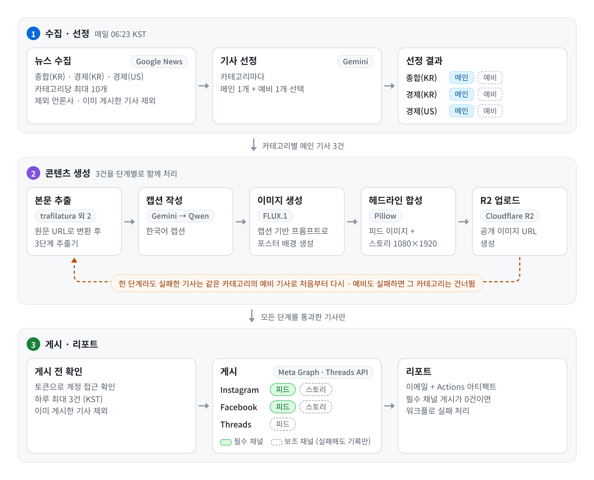
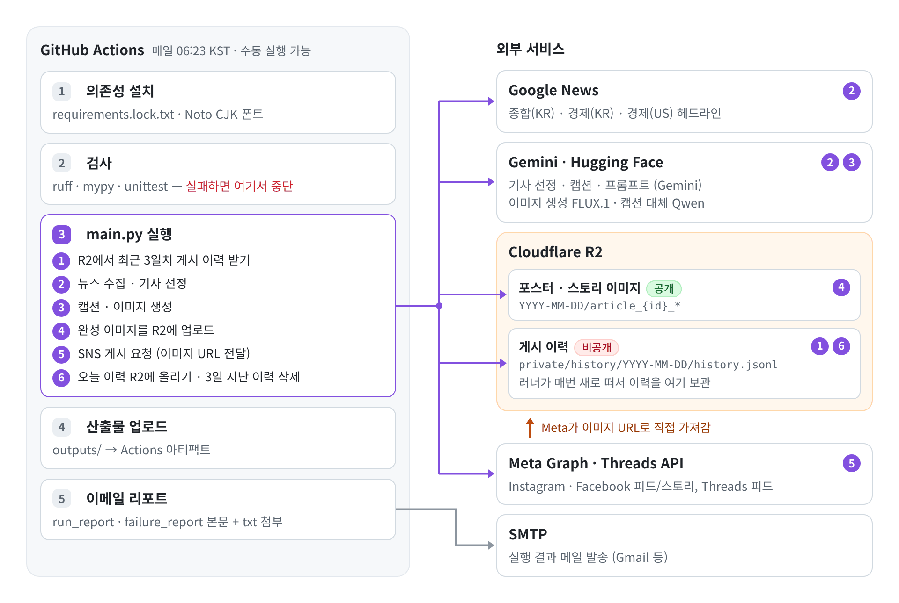

# Meta Automation

매일 아침 뉴스 기사를 골라 헤드라인 포스터 이미지와 한국어 캡션을 만들고, Instagram·Facebook·Threads에 자동으로 게시하는 프로젝트다. GitHub Actions에서 매일 06:23(KST)에 실행된다.

<p>
  
  
  
  
  
  
</p>

## 동작 과정

<picture>
  <source media="(prefers-color-scheme: dark)" srcset="docs/images/pipeline-dark.png">
  
</picture>

1. **뉴스 수집** — Google News에서 종합(KR), 경제(KR), 경제(US) 세 카테고리의 헤드라인을 카테고리당 최대 10개씩 가져온다. 제외 언론사(`news.py`의 `EXCLUDED_SOURCE_KEYWORDS`)와 이미 게시한 기사는 여기서 뺀다.
2. **기사 선정** — Gemini가 카테고리마다 메인 기사 1개와 예비 기사 1개를 고른다.
3. **본문 추출** — Google News 중계 링크를 원문 URL로 바꾼 뒤 본문을 가져온다.
4. **캡션 작성** — 기사 본문으로 Gemini가 한국어 캡션을 쓴다.
5. **이미지 생성** — 캡션을 바탕으로 이미지 프롬프트를 만들고, Hugging Face FLUX 모델로 이미지를 생성한 뒤 Pillow로 헤드라인을 얹는다. 스토리용 1080×1920 이미지도 같이 만든다.
6. **업로드** — 완성된 이미지를 Cloudflare R2에 올린다. Meta API가 공개 이미지 URL을 받아 가는 방식이라 R2를 이미지 호스팅으로 쓴다.
7. **게시** — Instagram, Facebook 페이지, Threads에 피드를 올리고 Instagram·Facebook에는 스토리도 올린다.
8. **리포트** — 실행 결과를 이메일로 받고, 산출물은 Actions 아티팩트로 남긴다.

메인 기사가 중간 단계에서 실패하면 같은 카테고리의 예비 기사로 처음부터 다시 진행한다. 둘 다 실패하면 그 카테고리는 그날 건너뛴다.

## 실패 대비

외부 API 하나가 막혀도 그날 게시가 통째로 빠지지 않도록 단계마다 대체 경로를 뒀다.

| 단계 | 시도 순서 |
| --- | --- |
| 이미지 생성 | `FLUX.1-dev`(28 steps) → `FLUX.1-schnell`(4 steps, guidance 0) → `FLUX.1-schnell`(4 steps, guidance 3.5) |
| Gemini 호출 | `gemini-3.5-flash` → `gemini-3.1-flash-lite` (429/503으로 재시도까지 실패한 경우) |
| 캡션 | Gemini 두 모델 → `Qwen/Qwen2.5-72B-Instruct` |
| 본문 추출 | `trafilatura` → `readability-lxml` → BeautifulSoup |

실제로 쓰인 캡션·이미지 모델은 기사 데이터에 기록되고 리포트에도 찍힌다.

## 게시 규칙

- 본문 추출, 캡션, 이미지 프롬프트, 이미지 생성, 헤드라인 합성, R2 업로드가 모두 끝난 기사만 게시한다.
- 게시 전에 각 토큰으로 계정에 접근할 수 있는지 먼저 확인한다. Instagram·Facebook 확인이 실패하면 게시 자체를 하지 않고, Threads 확인만 실패하면 Threads만 건너뛴다.
- 스토리는 같은 채널의 피드 게시가 성공했을 때만 올린다. 스토리가 실패해도 리포트에만 남기고 실행은 계속한다.
- 하루 게시 수는 `MAX_DAILY_POSTS`로 제한한다. 날짜 기준은 KST다.
- 이미 게시한 기사는 `history.jsonl`로 걸러낸다. 일부 채널에만 올라간 기사도 이력에 남겨서 다음 날 다시 올라가지 않게 했다.
- 매일 같은 시각에 올라가지 않도록 첫 게시는 `UPLOAD_WINDOW_MINUTES` 안에서 랜덤하게 늦추고, 그다음부터는 `POST_SPACING_MINUTES` 간격으로 올린다.
- 게시가 끝났는데 Instagram이나 Facebook 중 한쪽이라도 성공이 0건이면 워크플로를 실패로 끝낸다. Threads와 스토리 실패는 워크플로 실패로 치지 않는다.

## 실행 환경

`.github/workflows/daily-upload.yml`이 매일 `23 21 * * *`(UTC), 즉 06:23 KST에 실행된다. Actions 탭에서 수동으로 돌릴 수도 있다.

<picture>
  <source media="(prefers-color-scheme: dark)" srcset="docs/images/architecture-dark.png">
  
</picture>

워크플로 순서는 체크아웃 → Python 3.11·Noto CJK 폰트·의존성 설치 → `ruff`, `mypy`, `unittest` → `main.py` 실행 → 산출물 업로드 → 이메일 발송이다. 검사 단계에서 실패하면 게시까지 가지 않는다. `ci.yml`은 `main` 푸시와 PR마다 같은 검사만 돌린다.

게시 관련 환경 변수:

| 변수 | 운영값 | 코드 기본값 | 설명 |
| --- | --- | --- | --- |
| `DRY_RUN` | `false` | `false` | `true`면 콘텐츠만 만들고 게시는 건너뜀 |
| `MAX_DAILY_POSTS` | `3` | `3` | 하루 최대 게시 수 |
| `UPLOAD_WINDOW_MINUTES` | `15` | `120` | 첫 게시를 랜덤하게 늦출 최대 시간(분) |
| `POST_SPACING_MINUTES` | `5` | `10` | 게시물 사이 간격(분) |
| `ENABLE_STORIES` | `true` | `true` | 스토리 게시 여부 |

## 파일 구조

```text
main.py                    실행 진입점, 전체 순서 제어
config.py                  환경 변수 읽기
constants.py               상태값 문자열
models.py                  Article 데이터 클래스
time_utils.py              KST 날짜·시간 처리
news.py                    Google News 수집, 원문 URL 변환, 본문 추출
content.py                 Gemini 기사 선정, 캡션·이미지 프롬프트 생성, Qwen 대체
image_generation.py        Hugging Face 이미지 생성
image_rendering.py         헤드라인 합성, 스토리 이미지 렌더링
storage.py                 R2 업로드, 게시 이력 동기화
pipeline.py                콘텐츠 생성 흐름, 완성 여부 확인, 예비 기사 재시도
publishing.py              게시 전 확인, 일일 한도, 중복 방지, 게시 간격
instagram_publishing.py    Instagram 피드·스토리 게시
facebook_publishing.py     Facebook 페이지 피드·스토리 게시
threads_publishing.py      Threads 게시
outputs.py                 실행 산출물 저장
reporting.py               실행 요약·실패 리포트 생성
history.py                 게시 이력 기록, 중복 게시 확인
tests/                     단위 테스트
```

## 데이터 모델

기사 한 건의 처리 상태는 `models.Article` 하나로 관리한다. 단계마다 결과값, `*_status`, 에러를 필드로 남겨서 어느 단계에서 실패했는지 리포트에서 바로 보이게 했다. `from_dict()` / `to_dict()`로 기존 산출물과 호환되고, 정의되지 않은 필드는 `extra_fields`에 그대로 보존한다.

<details>
<summary>필드 목록</summary>

| 단계 | 필드 |
| --- | --- |
| 기사 정보 | `id`, `category`, `title`, `source`, `google_link`, `resolved_link`, `body`, `status` |
| 선정 | `selection_rank`, `backup_article` |
| 캡션 | `instagram_caption`, `instagram_caption_raw`, `instagram_caption_status`, `instagram_caption_model` |
| 이미지 프롬프트 | `sdxl_image_prompt`, `sdxl_image_prompt_raw`, `sdxl_image_prompt_status` |
| 이미지 | `image_path`, `image_generation_status`, `image_generation_model`, `image_generation_error`, `final_image_path`, `image_overlay_status` |
| 업로드 | `public_image_url`, `r2_upload_status`, `story_image_path`, `public_story_image_url` |
| 피드 게시 | `instagram_publish_*`, `facebook_publish_*`, `threads_publish_*` (`_status`, `_post_id`, `_error`), `publish_status` |
| 스토리 게시 | `instagram_story_*`, `facebook_story_*` (`_status`, `_id`, `_error`) |

</details>

## 산출물과 게시 이력

실행 결과는 `outputs/YYYY-MM-DD/`(KST)에 쌓인다.

- `run_report.txt` — 채널별 게시 수, 게시한 기사 제목, 사용한 모델, 게시물 ID
- `failure_report.txt` — 카테고리·기사·게시 단계별 실패 내역
- 그 밖에 Gemini 선정 결과, 캡션, 이미지 프롬프트, 생성 이미지 목록 등

두 리포트는 이메일 본문으로 오고, `outputs/**/*.txt`는 메일 첨부와 Actions 아티팩트로 남는다.

Actions 러너는 매번 새 환경에서 뜨기 때문에 로컬 `history.jsonl`이 다음 실행까지 남지 않는다. 그래서 실행을 시작할 때 R2 비공개 경로(`private/history/YYYY-MM-DD/history.jsonl`)에서 최근 3일치 이력을 받아오고, 끝나면 그날 이력을 다시 올린다. 3일이 지난 이력은 지운다. `history.jsonl`에는 게시물 ID와 URL이 들어 있어서 Git에는 올리지 않는다.

## 개발하면서 겪은 문제

- **pygooglenews import 실패** — 의존하는 feedparser 5.x가 최신 Python에서 제거된 `base64.decodestring`을 참조한다. import 전에 `base64.decodebytes`로 별칭을 만들어 해결했다. feedparser 5.x는 설치할 때도 `setuptools<58`이 필요하다.
- **googlenewsdecoder 업데이트 후 URL 변환 실패** — 0.2.0부터 성공 여부 키가 `status`에서 `success`로 바뀌었다. 버전을 0.1.7로 고정하고, 코드에서는 두 키를 모두 확인하게 했다.
- **selectolax 1.0 업데이트 후 import 실패** — googlenewsdecoder가 쓰는 Modest 백엔드가 selectolax 1.0에서 빠졌다. `selectolax<1.0`으로 고정했다.
- 위처럼 버전을 고정하지 않은 설치에서 새 릴리스 때문에 파이프라인이 깨진 적이 있어서, 지금은 하위 의존성까지 고정한 `requirements.lock.txt`로 설치한다.
- **일부 언론사 본문 수집 차단** — 기본 Python 요청을 막는 곳이 있어 브라우저와 비슷한 요청 헤더를 붙이고 본문 추출기를 3단계로 뒀다. 그래도 401/402/403을 돌려주는 곳이 있고, 본문을 끝내 못 가져오면 그 기사는 예비 기사로 교체된다.
- **Actions 로그 순서 꼬임** — stdout 버퍼링 때문에 트레이스백과 진행 로그 순서가 섞여서 원인을 찾기 어려웠다. 워크플로에 `PYTHONUNBUFFERED=1`을 설정했다.

## 로컬에서 실행하기

CI와 같은 방식으로 설치한다. feedparser 5.x 때문에 setuptools를 먼저 낮춰야 한다.

```bash
python3 -m venv venv
source venv/bin/activate

pip install --upgrade pip
pip install "setuptools<58" wheel
pip install --no-build-isolation -r requirements.lock.txt
pip install -r requirements-dev.lock.txt
```

환경 변수 파일을 만들고 키를 채운다. 항목은 아래 Secrets 목록과 같다.

```bash
cp .env.example .env
```

로컬에서는 `.env`에 `DRY_RUN=true`를 꼭 넣는다. 기본값이 `false`라서 빠뜨리면 실제 계정에 게시된다.

```bash
python main.py
```

운영 값은 GitHub Secrets에 따로 있으므로, 로컬 `.env`가 다르면 로컬 결과를 운영 기준으로 볼 수 없다.

## 테스트와 정적 검사

```bash
python3 -m ruff check .
python3 -m mypy .
python3 -m unittest discover -s tests
```

## GitHub Secrets

`Settings → Secrets and variables → Actions`에 등록한다.

```text
# Gemini / Hugging Face
GEMINI_API_KEY
HF_TOKEN

# Cloudflare R2
R2_ACCOUNT_ID
R2_ACCESS_KEY_ID
R2_SECRET_ACCESS_KEY
R2_BUCKET_NAME
R2_PUBLIC_BASE_URL

# Instagram / Facebook
META_ACCESS_TOKEN              Meta 비즈니스 시스템 사용자 토큰
IG_USER_ID                     Instagram 비즈니스 계정 ID
FACEBOOK_PAGE_ID               Facebook 페이지 ID
FACEBOOK_PAGE_ACCESS_TOKEN     /me/accounts에서 받은 페이지 토큰

# Threads
THREADS_ACCESS_TOKEN           Threads 장기 토큰
THREADS_USER_ID                Threads 프로필 ID

# 이메일 리포트 (Gmail 기준)
SMTP_HOST                      smtp.gmail.com
SMTP_PORT                      587
SMTP_USERNAME                  발신 Gmail 주소
SMTP_PASSWORD                  Gmail 앱 비밀번호
REPORT_EMAIL_TO                받는 주소
```

Meta 시스템 사용자에는 Facebook 페이지, Instagram 비즈니스 계정, Meta 앱 접근 권한을 할당해야 한다. 권한은 `pages_show_list`, `pages_read_engagement`, `pages_manage_posts`, `pages_manage_metadata`, `instagram_basic`, `instagram_content_publish`를 쓴다. Facebook 페이지 게시와 스토리에는 IG 토큰이 아니라 `pages_manage_posts` 권한이 있는 페이지 토큰이 필요하다.

Instagram과 Facebook 토큰은 채널별로 따로 교체하고 디버깅할 수 있게 분리해 뒀다. Threads 토큰은 만료 기간이 있어서 그 전에 갱신해야 한다.

## 운영 메모

- 출력 폴더, 포스터 날짜, 일일 게시 한도는 모두 KST 기준이다.
- Actions에서 수동 실행해도 `DRY_RUN=false`라서 실제로 게시된다.
- Meta에서 `OAuthException`, `code 190`, `Session has expired`가 나오면 토큰 문제다. 시스템 사용자 토큰, Threads 토큰, 자산 할당, Secrets 순서로 확인한다.
- `.env`와 `history.jsonl`은 `.gitignore`에 등록돼 있다. 커밋하지 않는다.
- Google Gemini, Hugging Face Inference, Cloudflare R2(S3 호환), Meta Graph, Threads Graph, SMTP 등 공식 API만 사용한다. 언론사 정책, 각 서비스 약관, Meta 플랫폼 정책, 저작권은 운영하는 쪽에서 지켜야 한다.
